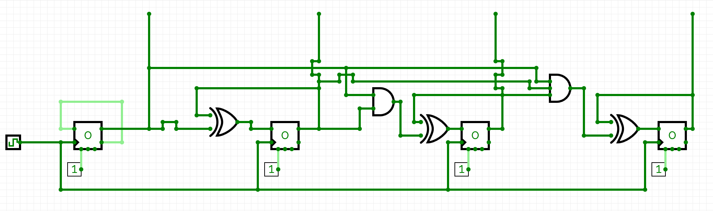
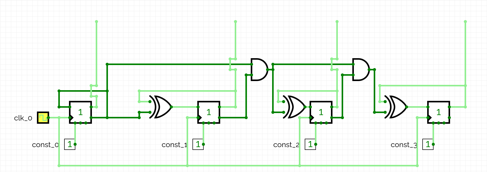

# 4-Bit Synchronous Up & Down Counters

A Verilog implementation of 4-bit synchronous binary up and down counters using custom-built D flip-flops constructed from NAND-gate-based D latches.

The project demonstrates sequential circuit design using basic logic gates, storage elements, Boolean expressions and clock-driven state transitions.

---

## 1. D Latch

A D latch is a level-sensitive storage element that stores one bit of information.

It has two primary inputs:
- `d_in`: Data input.
- `en`: Enable signal.

And two outputs:
- `Q`: Stored value.
- `Q_bar`: Complement of the stored value.

### Working Principle

The latch is implemented using NAND gates and feedback connections.

| Enable (`en`) | Behaviour |
|:---:|---|
| 0 | Retains the previously stored value |
| 1 | Output follows the data input |

When the enable signal is HIGH, the latch is transparent and its output follows the input. When the enable signal becomes LOW, it retains the last value.

---

## 2. D Flip-Flop

A D flip-flop is an edge-triggered storage element that captures its input only at a specific clock transition.

In this project, a positive-edge-triggered D flip-flop is constructed using two D latches in a master-slave configuration.

### Master-Slave Architecture

The two latches operate using complementary clock signals:

- **Master latch:** Enabled when the clock is LOW (`clk_not = 1`).
- **Slave latch:** Enabled when the clock is HIGH (`clk = 1`).

During the LOW clock phase, the master latch follows the input while the slave retains its previous value.

At the rising edge of the clock, the master closes and the slave opens, transferring the master latch's stored value to the output.

This makes the overall circuit positive-edge-triggered.

The fundamental behaviour is:

`Q(next) = D` at the rising edge of the clock.

---

## 3. 4-Bit Synchronous Up Counter

The up-counter increments its binary value by one at every rising edge of the clock.

It consists of four D flip-flops, each storing one bit of the counter:

`Q = {Q3, Q2, Q1, Q0}`

Here, `Q0` is the least significant bit (LSB), while `Q3` is the most significant bit (MSB).

The counter operates from `0000` (0) to `1111` (15), after which it wraps around to `0000`.

### Working Principle

Binary incrementing follows a carry-propagation mechanism.

- **Bit 0 (`Q0`):** Toggles on every clock cycle. Therefore, its next value is the complement of its current value.
- **Bit 1 (`Q1`):** Toggles whenever `Q0` is HIGH, indicating a carry from the least significant bit.
- **Bit 2 (`Q2`):** Toggles whenever both `Q0` and `Q1` are HIGH.
- **Bit 3 (`Q3`):** Toggles whenever all three lower-order bits are HIGH.

XOR gates implement the conditional toggling, while AND gates generate the carry conditions.

### Boolean Equations

The next-state equations for the four flip-flops are:

| Flip-Flop | Next-State Equation |
|---|---|
| D0 | `~Q0` |
| D1 | `Q1 XOR Q0` |
| D2 | `Q2 XOR (Q1 AND Q0)` |
| D3 | `Q3 XOR (Q2 AND Q1 AND Q0)` |

The AND gates determine when a higher-order bit must toggle, while the XOR gates combine the current bit with its corresponding carry condition.

### Example Transitions

| Current Count | Next Count |
|:---:|:---:|
| 0000 | 0001 |
| 0001 | 0010 |
| 0010 | 0011 |
| 0011 | 0100 |
| 0100 | 0101 |
| 0111 | 1000 |
| 1110 | 1111 |
| 1111 | 0000 |

The transition from `0111` to `1000` demonstrates carry propagation across multiple bits.



---

## 4. 4-Bit Synchronous Down Counter

The down-counter decrements its binary value by one at every rising edge of the clock.

Similar to the up-counter, it consists of four D flip-flops connected through combinational logic.

The counter operates from `1111` (15) down to `0000` (0), after which it wraps around to `1111`.

### Working Principle

Binary decrementing follows a borrow-propagation mechanism.

- **Bit 0 (`Q0`):** Toggles on every clock cycle.
- **Bit 1 (`Q1`):** Toggles whenever `Q0` is LOW, indicating a borrow condition.
- **Bit 2 (`Q2`):** Toggles whenever both `Q0` and `Q1` are LOW.
- **Bit 3 (`Q3`):** Toggles whenever all three lower-order bits are LOW.

The complemented outputs (`Q_bar`) of the flip-flops are used to generate the borrow conditions directly.

AND gates combine these conditions, and XOR gates determine the next value of each higher-order bit.

### Boolean Equations

The next-state equations are:

| Flip-Flop | Next-State Equation |
|---|---|
| D0 | `~Q0` |
| D1 | `Q1 XOR ~Q0` |
| D2 | `Q2 XOR (~Q1 AND ~Q0)` |
| D3 | `Q3 XOR (~Q2 AND ~Q1 AND ~Q0)` |

The complemented lower-order bits determine when a borrow must propagate to the next bit.

### Example Transitions

| Current Count | Next Count |
|:---:|:---:|
| 1111 | 1110 |
| 1110 | 1101 |
| 1101 | 1100 |
| 1100 | 1011 |
| 1000 | 0111 |
| 0010 | 0001 |
| 0001 | 0000 |
| 0000 | 1111 |

The transition from `1000` to `0111` demonstrates borrow propagation across multiple bits.



---

## 5. Repository Structure

| File | Description |
|---|---|
| `d_latch.v` | NAND-gate-based D latch |
| `d_flipflop.v` | Positive-edge-triggered master-slave D flip-flop |
| `up_counter.v` | 4-bit synchronous up-counter |
| `down_counter.v` | 4-bit synchronous down-counter |
| `up_counter_tb.v` | Testbench for the up-counter |
| `down_counter_tb.v` | Testbench for the down-counter |
| `up_counter.png` | Up-counter circuit diagram |
| `down_counter.png` | Down-counter circuit diagram |

---

## 6. Simulation

The circuits can be simulated using Icarus Verilog.

### Up Counter

Compile the Verilog modules:

```bash
iverilog -g2012 -o sim_upcounter d_latch.v d_flipflop.v up_counter.v up_counter_tb.v
```

Run the simulation:

```bash
vvp sim_upcounter
```

### Down Counter

Compile the Verilog modules:

```bash
iverilog -g2012 -o sim_downcounter d_latch.v d_flipflop.v down_counter.v down_counter_tb.v
```

Run the simulation:

```bash
vvp sim_downcounter
```

Both testbenches generate a 10 ns clock period and monitor the counter outputs throughout the simulation.

Since the flip-flops do not have a reset input, the testbenches initialise their outputs to zero using `force` and subsequently `release` them to allow normal circuit operation.

---

## 7. Key Concepts Demonstrated

- Level-sensitive storage using D latches.
- Edge-triggered storage using master-slave D flip-flops.
- Synchronous sequential circuit design.
- Boolean logic and combinational circuit construction.
- Binary carry and borrow propagation.
- Modular arithmetic in 4-bit counters.
- Verilog structural modelling and testbench-based simulation.

